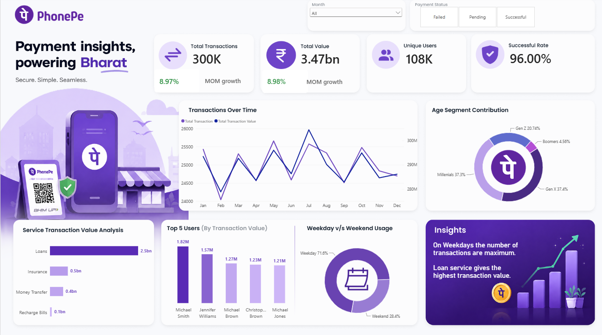

#  PhonePe Payment Insights Dashboard (Power BI)


## 📌 Project Overview
**"Payment insights, powering Bharat — Secure. Simple. Seamless."**

This project presents an end-to-end data analytics solution built in **Microsoft Power BI** to analyze digital payment transactions, user demographics, and service performance on **PhonePe**. By processing **300,000+ transaction records** across **107,600+ users**, this interactive dashboard uncovers transaction trends, demographic adoption, MoM (Month-over-Month) growth, and service-level revenue contributions.

---

## 🖼️ Dashboard Preview


---

## 📂 Dataset & Data Model
The underlying dataset (`Phonepe-Final-Dataset.xlsx`) consists of two relational tables connected via a 1-to-Many  relationship on `User_ID`:

1. **`All_Users` (Dimension Table - 107,658 rows)**
   * **Columns:** `User_ID`, `Name`, `Age`, `Join_Date`
2. **`All_Transactions` (Fact Table - 300,000 rows)**
   * **Columns:** `Transaction_ID`, `Amount`, `User_ID`, `Service`, `Service Type`, `Payment_Status`, `Reason`, `Date`

---

## 🛠️ Tech Stack & Workflow

### 1. Data Cleaning & Transformation (Power Query Editor)
* **Data Type Standardization:** Enforced proper data types for `Date`, `Join_Date`, and currency (`Amount`).
* **Text Formatting:** Cleaned service names (e.g., transforming `Recharge_Bills` and `Money_Transfer` for clean visual labeling) and standardized `Payment_Status` categories (`Successful`, `Failed`, `Pending`).
* **Feature Engineering (Custom/Conditional Columns):**
  * **Age Segmentation:** Grouped user ages into generational cohorts:
    * **Gen Z** (< 28 years)
    * **Millennials** (28 – 43 years)
    * **Gen X** (44 – 59 years)
    * **Boomers** (60+ years)
  * **Day Type Classification:** Extracted day of the week from `Date` to classify transactions into **Weekday** vs. **Weekend** usage.
* **Date Table Creation:** Built a dedicated Calendar/Date dimension for time-intelligence calculations (`Month`, `Month Number`, `Day Name`).

### 2. KPIs & DAX Measures
Key DAX measures created to power the dashboard KPIs and dynamic cards:

```dax
// 1. Total Transactions
Total Transactions = COUNT('All_Transactions'[Transaction_ID])

// 2. Total Transaction Value
Total Value = SUM('All_Transactions'[Amount])

// 3. Unique Users
Unique Users = DISTINCTCOUNT('All_Users'[User_ID])

// 4. Success Rate (%)
Successful Rate = 
DIVIDE(
    CALCULATE([Total Transactions], 'All_Transactions'[Payment_Status] = "Successful"),
    [Total Transactions],
    0
)

// 5. MoM Transaction Growth (%)
MoM Transaction Growth = 
VAR CurrentMonthTxns = [Total Transactions]
VAR PrevMonthTxns = CALCULATE([Total Transactions], DATEADD('Calendar'[Date], -1, MONTH))
RETURN
    DIVIDE(CurrentMonthTxns - PrevMonthTxns, PrevMonthTxns, 0)

// 6. MoM Value Growth (%)
MoM Value Growth = 
VAR CurrentMonthVal = [Total Value]
VAR PrevMonthVal = CALCULATE([Total Value], DATEADD('Calendar'[Date], -1, MONTH))
RETURN
    DIVIDE(CurrentMonthVal - PrevMonthVal, PrevMonthVal, 0)
